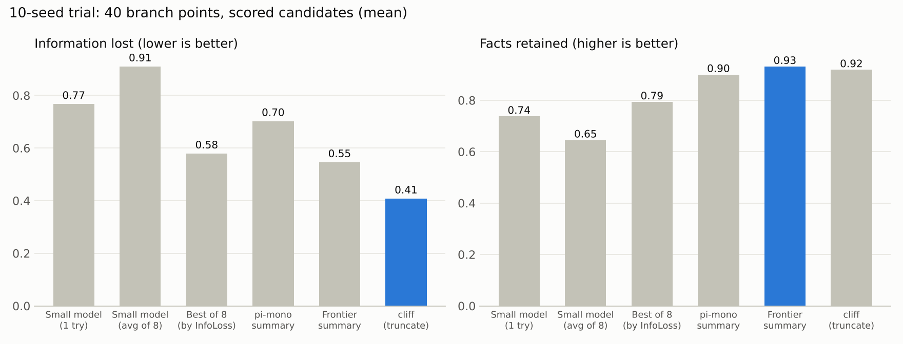
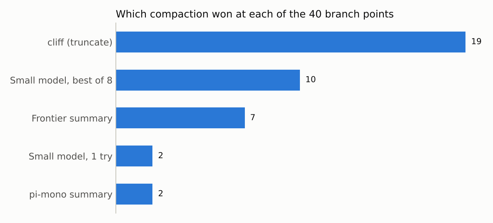

# Teaching a small model when to forget: building CompactGym

*A pilot for the Fireworks "Deploy" hackathon. The conclusion is a conditional go on supervised fine-tuning, and not yet on RL.*

## The problem

An AI agent has a limited context window. When it fills up, the agent has to compact its history: throw some of it away, summarize some of it, or move it to external memory. That's dangerous. A summary that drops "don't email Bob" or "the meeting moved to 3pm" makes the agent fail quietly, and nothing shows the loss until the agent does the wrong thing.

Today, compaction is a fixed recipe. Claude's API, Codex CLI and open-source agents like pi-mono each ship a summarization prompt, and a threshold triggers it. We wanted to know whether a small model could learn to **decide when and how to compact**, and do it better and cheaper than those recipes.

## What we built

**CompactGym** is a practice arena for compaction:

- **A mock email and calendar assistant.** It has a synthetic mailbox, deterministic tools, and a simulated user. We plant facts in the conversation: instructions, corrections, revised dates, decisions and reference numbers (the CONPACT taxonomy plus three new types).
- **A harness around the agent loop.** It enforces a token budget, hooks in before every turn, supports background compaction and a "pinned" tier of facts that must survive, and can **branch** from a snapshot. Branching lets us continue the same moment under many different compactions and measure the causal effect of each one.
- **Ten baseline compactors.**
  - Threshold summarizers using the pi-mono prompt and Anthropic's published compaction prompt. We have since added Codex's Apache-2.0 prompt.
  - `recent_k`, `memory_offload`, a frontier-model summarizer and a small prompted controller.
  - `cliff`, which truncates structure without rewriting anything.
- **Scoring.**
  - *InfoLoss*: how much worse the model predicts the next turns from the compacted context than from the full one.
  - A retention check on planted facts.
  - Forgetting detection and a success check that diffs the mailbox and calendar against the goal.
  - Cost and pause time.

## Pilot results

We ran 50 full-context episodes and scored about 190 branch points. We also ran 84 live branches (240 were planned).

1. **Best-of-8 beats a single attempt.** Sampling 8 compactions from the small model and keeping the one with the lowest InfoLoss cut InfoLoss from 0.756 to 0.445 (41% lower) and raised fact retention from 0.70 to 0.79.
2. **Live task success barely moves.** All ten compactors landed between 0.79 and 0.87 task success, and the differences weren't statistically significant.
3. **InfoLoss doesn't predict real failures.** Its correlation with live forgetting and failure was weak (Spearman 0.18 across branch points, 0.03 within them). This is the main caveat. Optimizing InfoLoss is not yet proven to improve outcomes.
4. **`cliff` is a hard bar to beat.** The cheap truncation method has the lowest InfoLoss of any baseline (0.316), the highest retention (0.92) and zero pause. It costs about $0.02 per continuation against $0.045 for the summarizers, and it stays stable under repeated compaction. A simple summarizer's error climbs to about 0.5 by the fifth compaction.
5. **Background compaction hides latency.** It cut pause from 21–236 s to about 0.1 s. Forced fallbacks dominated the savings in our tests, which were only a handful of runs.

**Recommendation:** a conditional go on supervised fine-tuning, and not yet RL. Best-of-8 is a plausible teacher, but we haven't shown it beats `cliff` on success per dollar. The controller's likely value is in choosing *between* truncation, summarization and offload, and in *when* to compact, because summaries cost seconds of blocking pause and break the prompt cache.

## The SFT data pipeline

After the pilot we ran a 10-seed trial of the SFT data pipeline:

1. Record full-context episodes (10 new seeds, 40 branch points).
2. At each branch point, sample 8 compactions from the small model at temperature 0.8. Add the `cliff`, frontier and `threshold_pi` outputs as extra candidates.
3. Score every candidate and keep the argmin of `λ·InfoLoss − retention`.
4. Use the winner's controller JSON (`action`, `summary`, `pinned`, `confidence`) as the training target. `confidence` is the winner's *measured* retention, so calibration is learned and not asserted.

What we saw in the trial:

- **Cost:** about $0.24 per seed for one clean pass at the code's placeholder prices (the real bill needs checking).
- **Winners:** `cliff` won 19 of 40 branch points, `small_sample` 10, `frontier` 7, `threshold_pi` 2 and plain `small_prompted` 2. Half the time, the best action is the free truncation.
- **Headline numbers:** the picked candidates beat a single small-model attempt on InfoLoss (0.78 to 0.24) and retention (0.71 to 0.99). This is inflated because winners can come from `cliff` and `frontier`. The fair best-of-8 comparison is the pilot's 41%.
- **Best-of-8 on its own is a smaller win here than in the pilot.** Mean InfoLoss fell from 0.77 (one try) to 0.58 (25%, against the pilot's 41%), and retention rose from 0.74 to 0.79. Ten seeds is a noisy sample, so treat the gap as unresolved. It is also notable that `cliff` (0.41) beats best-of-8 on InfoLoss, and that retention is highest for the frontier summary (0.93), `cliff` (0.92) and pi-mono (0.90).

- **Data quality:** the first pass kept only the winning summary, so we re-ran scoring to save every candidate. We also dropped candidates where the model's JSON failed to parse and the raw reply was stored as the summary.

## Caveats

- 40 examples can't train anything. The trial only validates the pipeline.
- Because InfoLoss is a weak proxy for live outcomes, selecting teachers by it could mislead.
- The SFT builder doesn't yet apply the "don't lose a pinned fact" filter. It only uses retention.
- Prices in the code are placeholders. The tracked spend for the whole project was about $33.5 for the pilot and about $4.50 for the trial, so check the real Fireworks bill.
- The frontier compactor is a stand-in (`glm-5p3` on Fireworks), not a closed model. The Anthropic API path has never been called.
- The live-branch sample is small (84 of 240 planned).

## What's next

**Before scaling up**

1. Read through the 40 trial examples, and add the pinned-fact filter to the SFT builder.
2. Fix the known pilot issues:
   - `constraint_extractor` pinned nothing at first. The token cap is raised, but the fix is untested against the API and the prompt may need adapting.
   - InfoLoss is clipped at zero, which flattens 8–19% of compactions. Try the signed value or a margin.
   - Stricter persona prompts for the simulated user, since about 30% of rewrites fall back to the canned script.
   - Re-price the runs once the real Fireworks rates are known. Token counts are logged, so this can be done afterwards.
3. Swap the stand-in frontier compactor for a closed model, and re-run the baselines with `threshold_codex`.

**SFT data at scale**

4. Scale to about 100 seeds (about $25) first, then toward the ~2,000 seeds in the plan if the data looks good. The runs skip finished work, so they can resume.
5. Add long-context data from Hermes Agent and OpenResearcher (CONPACT sources). These are tens of GB, so they have to be generated on a cloud box with at least 200 GB of disk, and only the sampled episodes copied back. They have no tool-use environment, so only InfoLoss and retention can score them.
6. Train a LoRA with SFT on Fireworks.

**Then RL, once the reward is validated**

7. First check on the live branches that InfoLoss points the same way as forgetting and failure. Our pilot correlation was weak, so this decides whether it can be part of the reward.
8. Train the small compactor and keep the main agent frozen. Use the reward `success − pause − forgetting − cost − λ·InfoLoss`, with λ set so the InfoLoss term is about 10–20% of reward variance.
9. Normalize the loss per token across the batch, because summaries vary 10x in length and tend to grow without a cost term.
10. Handle credit across compactions. Run G=8 branches from the same snapshot so each compaction's advantage is its outcome minus the group mean. Discount later effects by the repeated-compaction survival curve, and give pinned facts an immediate reward.
11. Plan a dedicated deployment for the main model. The serverless endpoint rate-limited us at about 8 concurrent requests.

**What the pilot says to change in the design**

12. Train the controller to choose between `cliff`-style truncation, summarization and offload each turn, not to replace them. `cliff` stays the default fallback.
13. Its main value is probably *when* to compact. Test longer horizons after the branch point and a harder 8K budget, where compaction fires 4–6 times per session.

*CompactGym builds on CONPACT (compaction-integrity) and CliffCompaction, both MIT-licensed, and uses Codex's open-source compaction prompt (Apache-2.0).*
