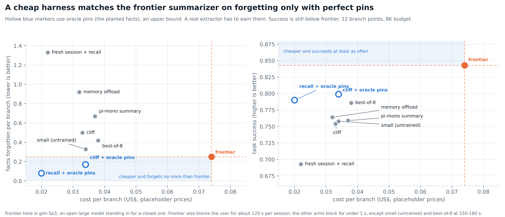

# What does an agent forget when its memory gets squeezed?

You are an hour into a session with an AI agent. A progress bar appears: *Compacting our conversation so we can keep chatting…* It sits at 93% for a few minutes. When it finishes, the agent carries on as if nothing happened.

Did it keep the thing you told it at the start? You usually find out twenty turns later.

We built **CompactGym** to measure that. It is a small open environment for the moment an agent has to forget: it plants facts, squeezes the history, and checks what survived, along with what the squeezing cost in money and waiting time.

## The problem

Agents run out of room. To keep going, they compact: summarize the history, trim it, or move it aside. Three things make this hard to study.

- **It is silent.** If "don't email Jonas" is lost, nothing errors. The agent keeps working, confidently.
- **It is delayed.** The mistake shows up many turns after the compaction that caused it.
- **It is priced.** Summaries cost tokens, break the prompt cache, and make the user wait. Quality is only half the bill.

Small windows make this constant. Apple's on-device model has a 4,096 token window shared between the prompt and the answer, and local models often default to a few thousand. For an agent running there, compaction is not a feature. It is the whole game.

## The gym

A simulated email and calendar assistant works through 28 requests from a simulated user. Early in the session the user states facts that matter later: a person to leave out of a thread, a date that moved, a reference number. Late requests depend on them.

Success comes from diffing the final mailbox and calendar against the goal, and forgotten facts come from rule-based detectors, so no language model decides what counts as forgotten. A fact only counts if the full-context agent got it right, which keeps the measure clean.

The key tool is **branching**. Any step can be snapshotted and replayed under a different compactor with identical seeds. The difference between two branches is the effect of the compaction itself.

We compare ten methods, including the compaction prompts from Anthropic's API docs, Codex CLI and pi-mono, plain truncation, retrieval, and a frontier-model summarizer.

**Hard mode.** At a 16K budget almost nothing was forgotten, so there was nothing to measure. Hard mode plants facts in the first few turns, asks for them only in the last 40% of the session, never repeats them, and zeroes a goal when its fact is violated. At an 8K budget a session compacts about 17 times.

## What we found

All numbers below are from hard mode at an 8K budget, on 12 to 14 live branches per method. They are small samples.

**1. The frontier summarizer forgets least, and charges for it.** It forgot 0.25 facts per session and succeeded on 84% of goals. It also cost $0.074 per session (placeholder prices) and blocked the user for about two minutes. Plain rule-based truncation forgot 0.50 facts at $0.033 with no wait.

**2. A popular quality metric points the wrong way.** InfoLoss measures how much worse a model predicts the next turns after a compaction. It looks like a natural training signal. Against facts really forgotten later, it correlated negatively: ρ = −0.33 (95% CI −0.54 to −0.08). One compaction is not the seventeen that follow it. We set its weight to zero.

**3. "Keep the log and let the agent search it" forgot the most.** Never summarize, retrieve exact text on demand: it is an appealing idea, and we built it. It forgot 1.33 facts per session, five times the summarizer. The agent searched about once per session. You cannot search for a rule you do not know you forgot.

**4. Pinning the standing rules closes the gap.** Keep the user's instructions in a short pinned list that is always visible, then compact everything else cheaply. With the true facts pinned:

| Method | Forgotten | Success | Cost | Wait |
|---|---|---|---|---|
| frontier summarizer | 0.25 | 0.84 | $0.074 | ~120 s |
| truncation + pins | 0.17 | 0.80 | $0.034 | 0.1 s |
| retrieval + pins | 0.08 | 0.79 | $0.020 | 0 s |



That is 2 to 4 times cheaper, with equal or less forgetting and no wait.

## What this does and does not show

The pins above are an **oracle**: we handed the harness the planted facts. A real system has to find them. In a zero-shot test, open "flash" models found about half the facts worth pinning (recall 0.54, precision about 0.4). That is real headroom, and because the labels are exact, a small model can be trained for this one job. But nobody has trained it here yet, so the honest claim is a ceiling, not a result.

Task success is also still about 0.05 below the frontier summarizer, a gap that holds when paired by branch point (interval 0.04 to 0.13).

## What we got wrong

We think the corrections are worth publishing.

- **The buried-fact test did not test what we meant.** We expected facts that live only in a long email body to hurt truncation. They did not, and our first explanation, that agents re-read the email, was a miscount. A likelier cause is our own prompt, which asked the agent to summarize the email, so it restated the fact in its own reply.
- **Our first reward check was flawed.** We resumed some episodes with only two or three turns left, which made forgetting look rarer than it is.
- **A memory-search bug understated retrieval.** Trailing punctuation broke keyword search. It is fixed and tested.

## Limits

- Samples are small: 12 to 14 branches per method.
- "Frontier" is an open large model standing in for a closed one. We have not tested Claude or GPT.
- Prices are placeholders, so read ratios, not dollars.
- Budgets of 8K and 16K stand in for on-device windows and long sessions. Current models have far larger windows.
- The environment is simulated, with short and explicit instructions.

## Try it

```bash
uv sync --extra dev && uv run pytest
COMPACTGYM_SPEC=hard COMPACTGYM_BUDGET=8000 \
  uv run python -m compactgym.runner.pilot record --out outputs/hard --n 2012 --start 2000
uv run python scripts/validate_reward.py outputs/hard/
```

One episode costs about $0.07 to record, one branch point about $0.04 to score, and one live branch $0.02 to $0.07. The code and an interactive walkthrough are at github.com/ankittandon/CompactGym.
